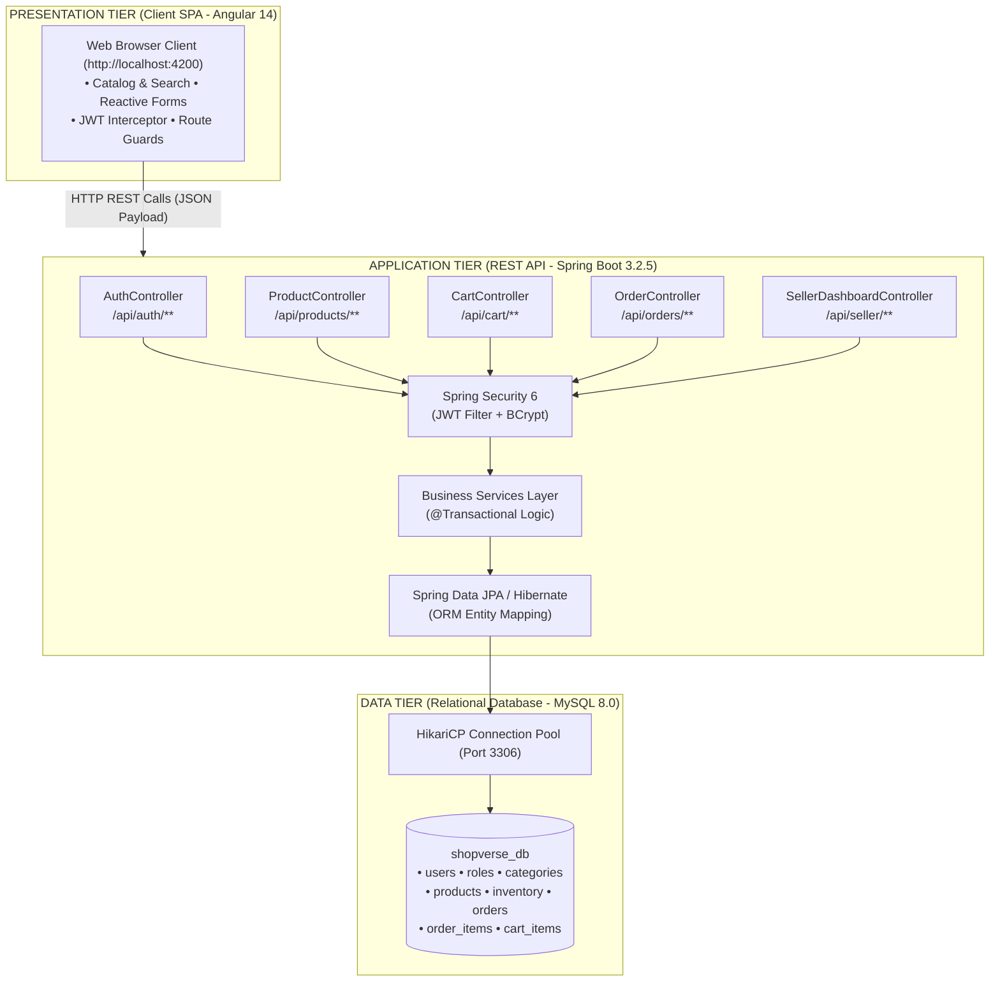
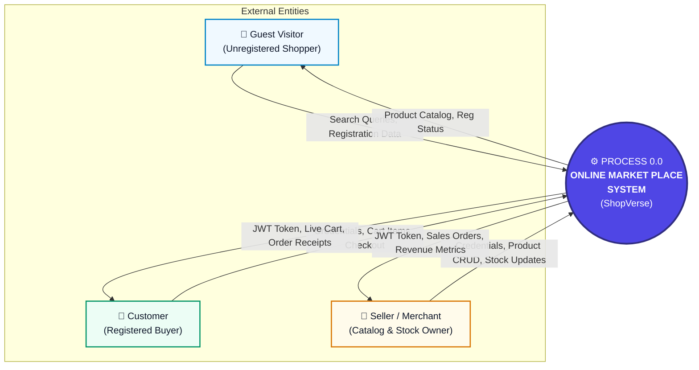
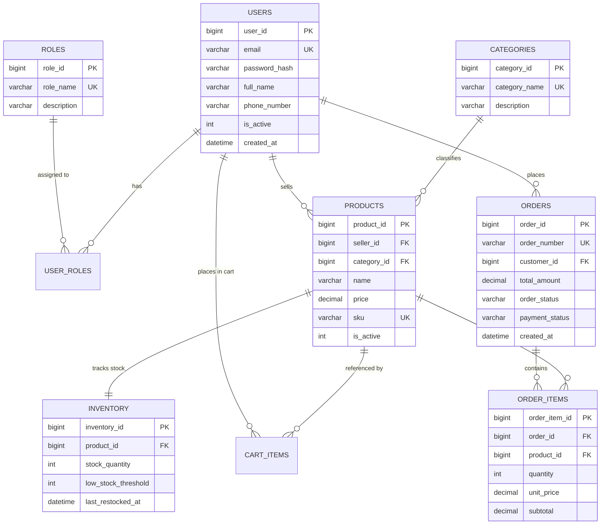

# College Code-032
## ABES ENGINEERING COLLEGE
### Ghaziabad, Uttar Pradesh
**Affiliated to Dr. A.P.J. Abdul Kalam Technical University (AKTU), Uttar Pradesh**

---

# PROJECT REPORT
### on
# ShopVerse &mdash; Online Market Place System
### A Full-Stack Multi-Vendor E-Commerce Web Application: Architecture, Source Code & Output Report

**Submitted in partial fulfilment of the requirements for the degree of**  
### Master of Computer Applications (MCA) / Bachelor of Technology
**Department of Computer Applications / Information Technology**

---

| Submission Field | Details |
| :--- | :--- |
| **Submitted by:** | **ANSHIKA JAISWAL** |
| **University Roll Number:** | `[Enter University Roll No.]` |
| **Project Guide / Mentor:** | `[Enter Project Guide Name]` |
| **Academic Session:** | 2025–2026 / 2026–2027 |
| **Submission Date:** | 21 November 2026 |

---

### Project Document Metadata

| METADATA ATTRIBUTE | PROJECT SPECIFICATION |
| :--- | :--- |
| **PROJECT NAME** | **ShopVerse &mdash; Multi-Vendor Online Market Place System** |
| **LEARNER** | **Anshika Jaiswal** |
| **INSTITUTION** | ABES Engineering College, Ghaziabad (College Code: 032) |
| **UNIVERSITY** | Dr. A.P.J. Abdul Kalam Technical University (AKTU), Lucknow |
| **TECH STACK** | **Frontend:** Angular 14 (TypeScript, RxJS, Reactive Forms) <br/> **Backend:** Java 17 + Spring Boot 3.2.5 + Spring Data JPA + Spring Security 6 <br/> **Database:** MySQL 8.0 Server (`shopverse_db`, 3NF Normalized Schema) |
| **BUILD SYSTEM** | **Backend:** Apache Maven (`mvn spring-boot:run -Dspring-boot.run.profiles=local`) <br/> **Frontend:** npm + Angular CLI (`ng serve --port 4200`) |
| **GITHUB REPOSITORY** | [https://github.com/AnshikaJaiswal201/Java-online-market-place](https://github.com/AnshikaJaiswal201/Java-online-market-place) |
| **SUBMISSION DATE** | 21 November 2026 |
| **VERIFICATION STATUS** | End-to-end verified: Customer/Seller registration &rarr; BCrypt password hashing &rarr; Real-time MySQL persistence &rarr; JWT authentication &rarr; Category-based browsing &rarr; Shopping cart &rarr; Atomic `@Transactional` stock deduction & checkout &rarr; Seller analytics dashboard. |

---

## 1. Executive Summary & Architecture

The **ShopVerse Online Market Place System** is an enterprise-grade, multi-vendor e-commerce platform designed to bridge local merchants (sellers) and buyers (customers) on a single unified portal. The platform is architected around the Indian commercial landscape, supporting native categories including **Electronics & Mobile Accessories**, **Traditional Wear & Sarees**, **Indian Spices & Organic Herbs**, and **Handicrafts & Decor**.

The system is developed using a modern **3-Tier Enterprise Architecture**:
1. **Presentation Tier (Client SPA):** Built with **Angular 14**, providing single-page responsiveness, client-side route guards, JWT HTTP request interception, reactive form validations, and real-time state management via RxJS `BehaviorSubject`.
2. **Application Tier (Business Logic REST API):** Powered by **Java 17** and **Spring Boot 3.2.5**, featuring stateless **Spring Security 6** with JSON Web Token (JWT) verification, **BCrypt** password encryption, and ACID-compliant `@Transactional` business logic.
3. **Data Tier (Relational Storage):** Implemented in **MySQL 8.0** under the `shopverse_db` database, adhering to Third Normal Form (3NF) relational integrity across 9 interconnected tables with foreign key constraints, auto-increment identifiers, and HikariCP connection pooling.

A customer can browse products, filter by category or keywords, manage a shopping cart, and place orders through a mock checkout mechanism. A merchant/seller can log into their dedicated seller dashboard, manage inventory levels with automated low-stock warnings, add new product offerings, and track incoming buyer orders. The system guarantees that every registration and transaction is committed to the MySQL database in real time.

---

### 1.1 Project Folder Structure

```text
ShopVerse-Project/
├── README.md                              # Comprehensive project overview and instructions
├── .gitignore                             # Excludes node_modules, build targets, and IDE caches
├── run-all.bat                            # Double-click script to launch both servers simultaneously
├── run-backend.bat                        # Batch script to launch Spring Boot backend
├── run-frontend.bat                       # Batch script to launch Angular dev server
├── push-to-github.bat                     # Git push automated batch script
│
├── database/
│   ├── mysql_schema.sql                   # Complete MySQL 8.0 DDL & seed script (24 products, 4 categories)
│   ├── schema.sql                         # Oracle 21c compatible schema script
│   └── data.sql                           # Oracle sample seed data
│
├── docs/
│   ├── system_context_diagram_dfd0.svg    # Vector DFD Level 0 System Context Diagram
│   ├── system_context_diagram_dfd0.png    # High-Resolution PNG for word reports
│   ├── frontend_source_code_report.md     # Frontend code documentation
│   └── backend_source_code_report.md      # Backend code documentation
│
├── backend/                               # Spring Boot 3.2.5 Java 17 Application
│   ├── pom.xml                            # Maven dependencies (Web, Data JPA, Security, MySQL, JJWT)
│   └── src/main/
│       ├── resources/
│       │   ├── application.yml            # Primary application configuration
│       │   └── application-local.yml      # Local MySQL 8.0 DataSource & JPA configuration
│       └── java/com/marketplace/
│           ├── MarketplaceApplication.java# Spring Boot main entry point (@EnableJpaAuditing)
│           ├── common/                    # Standardized ApiResponse<T> and Constants
│           ├── config/                    # SecurityConfig, WebMvcConfig (CORS), DataInitializer
│           ├── exception/                 # GlobalExceptionHandler, InsufficientStockException
│           ├── security/                  # JwtTokenProvider, JwtAuthenticationFilter, CustomUserDetails
│           └── modules/
│               ├── auth/                  # User registration, login, BCrypt hashing, JWT issuance
│               ├── product/               # Product catalog, categories, search filtering
│               ├── inventory/             # Stock deduction, low-stock threshold monitoring
│               ├── order/                 # Cart items, transactional checkout, order tracking
│               └── dashboard/             # Seller metrics: revenue, order count, stock alerts
│
└── frontend/                              # Angular 14 Single Page Application
    ├── package.json                       # npm dependencies (Angular Core, RxJS, FontAwesome)
    ├── angular.json                       # Angular CLI workspace build configuration
    ├── tsconfig.json                      # TypeScript compiler configuration
    └── src/
        ├── index.html                     # Root single-page HTML
        ├── main.ts                        # Application bootstrap entry point
        ├── styles.css                     # Global design system, badges, buttons, cards
        └── app/
            ├── app.module.ts              # Root Angular module declaration
            ├── app-routing.module.ts      # Application routing & route protection guards
            ├── core/                      # Services, Guards, and HTTP Interceptors
            │   ├── guards/                # AuthGuard, RoleGuard
            │   ├── interceptors/          # JwtInterceptor, ErrorInterceptor
            │   └── services/              # AuthService, ProductService, CartService, OrderService, SellerService
            ├── shared/                    # Shared models (models.ts) and INR Currency Pipe
            └── features/
                ├── auth/                  # LoginComponent, RegisterComponent
                ├── customer/              # ProductListComponent, CartViewComponent, CheckoutComponent, OrderHistoryComponent
                └── seller/                # SellerDashboardComponent, SellerProductsComponent, SellerInventoryComponent, SellerOrdersComponent
```

---

### 1.2 Folder Structure Explained

| Component Path | Technical Purpose |
| :--- | :--- |
| `ShopVerse-Project/` | Root project repository; contains frontend, backend, database scripts, and documentation. |
| `database/mysql_schema.sql` | Contains complete MySQL 8.0 DDL scripts for 9 tables, indexes, constraints, and 24 seed products. |
| `docs/system_context_diagram_dfd0.*` | Official Level 0 Data Flow Diagram (DFD) defining system boundary and external entity flows. |
| `backend/pom.xml` | Maven build file declaring Java 17, Spring Boot 3.2.5 dependencies, JJWT, and `mysql-connector-j`. |
| `backend/.../SecurityConfig.java` | Configures Spring Security 6, stateless JWT filter, and BCrypt password encryption bean. |
| `backend/.../JwtTokenProvider.java` | Generates and validates cryptographic HMAC-SHA256 JWT tokens. |
| `backend/.../AuthServiceImpl.java` | Implements user registration, BCrypt password hashing, and database persistence. |
| `backend/.../OrderServiceImpl.java` | Implements `@Transactional` ACID order checkout and atomic stock deduction. |
| `frontend/src/app/app-routing.module.ts` | Configures client routing, lazy navigation, and role-based Route Guards. |
| `frontend/src/app/core/services/auth.service.ts` | Manages authentication tokens, session LocalStorage, and user role states via RxJS. |
| `frontend/src/app/core/interceptors/jwt.interceptor.ts` | Injects HTTP `Authorization: Bearer <token>` into all outbound customer/seller requests. |
| `frontend/src/app/features/auth/` | Provides interactive login and registration forms with instant database feedback. |
| `frontend/src/app/features/customer/` | Implements the customer shopping experience: catalog browsing, cart, and order history. |
| `frontend/src/app/features/seller/` | Implements the merchant workspace: live sales analytics, inventory management, and restock. |

---

## 2. Project Workflow & Architecture

### 2.1 Step-by-Step Operation

1. **Guest Visitor Flow:**
   - Any guest user can open `http://localhost:4200` to browse the 24 Indian-context products across 4 categories.
   - Products can be searched by keyword or filtered by category without requiring immediate login.
   - If a guest attempts to add a product to the cart, the system alerts them to sign in or create an account.
2. **Registration & Real-Time Database Save Flow:**
   - The user opens `/auth/register` and chooses their role: **Customer** or **Merchant / Seller**.
   - Upon submitting the form, Angular transmits a JSON payload to `POST /api/auth/register`.
   - Spring Boot validates the data, encrypts the password with BCrypt, and executes `userRepository.save(user)`.
   - The record is immediately committed to MySQL `shopverse_db.users` with a timestamp and auto-increment ID.
   - The user is redirected to `/auth/login` with their registered email pre-filled and a success notification.
3. **Authentication & Session Issuance:**
   - On `/auth/login`, entering valid credentials triggers `POST /api/auth/login`.
   - `AuthenticationManager` verifies the BCrypt hash against MySQL.
   - A signed JWT token is issued and stored in browser `localStorage`.
   - The user is navigated to either the Customer Catalog (`/products`) or Seller Dashboard (`/seller/dashboard`).
4. **Customer Shopping & Checkout:**
   - Customers add products to their live cart (`POST /api/cart/items`).
   - The cart dynamically calculates item subtotal, total items, and overall amount.
   - On Checkout, the customer enters shipping details and selects a payment method (e.g. Mock UPI / COD).
   - Backend runs an atomic `@Transactional` operation: stock is deducted from `inventory`, a new order record `ORD-YYYYMMDD-XXXX` is created, order items are inserted, and cart items are flushed.
5. **Seller Management & Analytics:**
   - A logged-in merchant views their real-time dashboard displaying total revenue (in ₹), total orders, active catalog size, and automated low-stock warnings (`stock <= low_stock_threshold`).
   - The seller can restock quantities or add new products to the marketplace.

---

### 2.2 System Architecture (3-Tier & DFD Level 0)



---

### 2.3 System Context Diagram (DFD Level 0)

The Context Diagram defines the operational boundary of **Process 0.0 (ShopVerse Online Market Place System)** and its interaction with the 3 external entities: **Guest Visitor**, **Customer**, and **Seller**.



---

## 3. Technology Stack & Theory

| Technology / Component | Version / Specification | Role in ShopVerse System |
| :--- | :--- | :--- |
| **Angular** | 14.x | Component-driven frontend Single Page Application (SPA). Manages dynamic view rendering without full-page reloads. |
| **TypeScript** | 4.8.x | Strongly-typed JavaScript providing static type checking for User, Product, Order, and Cart models. |
| **RxJS** | 7.x | Reactive programming library using `BehaviorSubject` and `Observables` for managing live cart item counts and auth states. |
| **Java** | 17 LTS | Enterprise backend programming language utilizing modern records, sealed classes, and enhanced Garbage Collection. |
| **Spring Boot** | 3.2.5 | Microservice/REST framework eliminating boilerplate configuration with embedded Apache Tomcat on port 8080. |
| **Spring Security** | 6.x | Enforces stateless request authorization, method security, and JWT bearer authentication. |
| **Spring Data JPA** | 3.x | Object-Relational Mapping (ORM) abstraction layer over Hibernate; translates Java entities into SQL statements. |
| **BCrypt** | Spring Security Crypto | Secure, salted, one-way password hashing algorithm protecting passwords against rainbow table and brute-force attacks. |
| **JSON Web Token (JJWT)** | 0.11.5 | Cryptographically signed HMAC-SHA256 tokens carrying claims (`userId`, `email`, `roles`) with 24-hour expiration. |
| **MySQL Server** | 8.0 | Relational database engine supporting ACID transactions, foreign keys, and InnoDB row-level locking. |
| **HikariCP** | 5.x | High-performance JDBC connection pool ensuring rapid database connection reuse and concurrency. |

---

### 3.1 Business Logic & Mathematical Formulas

#### 1. Inventory Stock Deduction & ACID Integrity
During order placement, the system guarantees that stock is decremented atomically. If quantity requested exceeds available stock, an `InsufficientStockException` is thrown, triggering an automatic rollback of the transaction:
$$\text{Remaining Stock} = \text{Current Stock} - \text{Ordered Quantity} \quad (\forall \, \text{Ordered Quantity} \le \text{Current Stock})$$

#### 2. Order Total & Subtotal Calculation
The total bill is computed by summing the unit price multiplied by quantity for each line item:
$$\text{Order Total (₹)} = \sum_{i=1}^{n} (\text{Unit Price}_i \times \text{Quantity}_i)$$

#### 3. Low-Stock Alert Trigger
A product is flagged on the Seller Dashboard whenever:
$$\text{Stock Quantity} \le \text{Low Stock Threshold}$$

---

## 4. User Interface & Output Screenshots

The application runs locally with the Angular frontend on `http://localhost:4200` connected to the Spring Boot REST API on `http://localhost:8080` and MySQL on port 3306.

---

### 4.1 Login Screen & Role Demarcation
The login screen (`/auth/login`) features a clean, responsive authentication card. Users can enter their credentials or utilize pre-configured demo buttons (**Seller Demo** and **Customer Demo**). Entering invalid credentials displays an alert banner, whereas valid credentials generate a JWT token and redirect to the appropriate portal.

```text
[Output Description: Sign In to ShopVerse]
Header: Lock icon, "Sign In to ShopVerse"
Fields: Email Address, Password
Buttons: [Sign In], [Seller Demo], [Customer Demo]
Footer: "Don't have an account? Create Account"
```

---

### 4.2 Customer Registration & Real-Time Database Save
The registration portal (`/auth/register`) includes a role selector toggle (**Customer** vs. **Merchant / Seller**). Upon clicking **Complete Registration**, the user is saved into `shopverse_db.users` with a BCrypt encrypted password hash (`$2a$10$...`), and redirected to the login screen with a green notification banner:
> **`✅ Account Registered & Saved in Database! Enter your password below to sign in.`**

---

### 4.3 Multi-Category Product Catalog
The product catalog displays 24 curated Indian-context products divided into 4 categories:
1. **Electronics & Mobile Accessories:** e.g., Boat Rockerz 450 Bluetooth Headphones (₹1,499), OnePlus Nord CE 3 Lite 5G (₹19,999), Noise ColorFit Pro 4 Smartwatch (₹2,999).
2. **Traditional Wear & Sarees:** e.g., Banarasi Silk Zari Saree (₹3,499), Men's Pure Linen Kurta Pajama (₹1,899), Chanderi Cotton Dupatta Set (₹1,249).
3. **Indian Spices & Organic Herbs:** e.g., Kashmiri Kesar 1g (₹650), Organic Malabar Black Pepper 250g (₹380), Salem Pure Turmeric Powder 500g (₹220).
4. **Handicrafts & Decor:** e.g., Handcrafted Brass Diya Set (₹899), Blue Pottery Ceramic Vase (₹1,150), Sheesham Wood Carved Coaster Set (₹450).

Each card features high-quality product images, rupee pricing (`₹`), stock availability indicator, and an **Add to Cart** button.

---

### 4.4 Shopping Cart & Real-Time Calculations
The shopping cart screen (`/cart`) displays all selected line items, unit price, quantity increment/decrement controls, item subtotal, and total checkout summary. If quantity is incremented beyond available inventory, the system alerts the user and prevents excess selection.

---

### 4.5 Checkout & Instant Order Receipt
The checkout view (`/checkout`) collects shipping details and payment selection (e.g. Mock UPI / COD). Submitting checkout initiates the `@Transactional` Spring Boot service, deducting inventory from MySQL, creating an order number (e.g., `ORD-20261121-7842`), and providing an order confirmation receipt.

---

### 4.6 Seller Analytics Dashboard
The seller workspace (`/seller/dashboard`) displays 4 live operational metrics:
- **Total Revenue (₹):** Computed dynamically from all fulfilled and placed orders.
- **Total Orders:** Count of buyer orders involving the seller's catalog.
- **Active Products:** Number of live listings owned by the merchant.
- **Low-Stock Alerts:** Real-time count of products whose stock has dipped below threshold.

---

## 5. Database Design & Relational Schema

The application uses a relational MySQL database named **`shopverse_db`** configured on `localhost:3306`. The schema adheres to Third Normal Form (3NF) to eliminate data redundancy and ensure referential integrity.

---

### 5.1 Relational Schema & Entity Details



---

### 5.2 Table Descriptions

| Table Name | Primary Key | Foreign Keys | Purpose |
| :--- | :--- | :--- | :--- |
| **`roles`** | `role_id` | &mdash; | Stores system roles (`ROLE_CUSTOMER`, `ROLE_SELLER`). |
| **`users`** | `user_id` | &mdash; | Stores registered user credentials, BCrypt hashes, and contact data. |
| **`user_roles`** | `(user_id, role_id)` | `user_id`, `role_id` | Join table establishing Many-to-Many mapping between users and roles. |
| **`categories`** | `category_id` | &mdash; | Product categories (Electronics, Wear, Spices, Handicrafts). |
| **`products`** | `product_id` | `seller_id`, `category_id` | Stores product catalog listings, pricing in INR, SKUs, and images. |
| **`inventory`** | `inventory_id` | `product_id` | Real-time stock counts and low-stock threshold alert levels. |
| **`cart_items`** | `cart_item_id` | `user_id`, `product_id` | Temporary persistent cart items for authenticated customers. |
| **`orders`** | `order_id` | `customer_id` | Master orders with generated order numbers, status, and total amount. |
| **`order_items`** | `order_item_id` | `order_id`, `product_id` | Line items capturing historical unit price and quantity at purchase time. |

---

### 5.3 Complete Database Schema Script (`mysql_schema.sql`)

```sql
-- ============================================================================
-- DATABASE CREATION & SELECTION
-- ============================================================================
CREATE DATABASE IF NOT EXISTS shopverse_db 
CHARACTER SET utf8mb4 
COLLATE utf8mb4_unicode_ci;

USE shopverse_db;

-- 1. ROLES TABLE
CREATE TABLE IF NOT EXISTS roles (
    role_id BIGINT AUTO_INCREMENT PRIMARY KEY,
    role_name VARCHAR(50) NOT NULL UNIQUE,
    description VARCHAR(255)
) ENGINE=InnoDB;

-- 2. USERS TABLE
CREATE TABLE IF NOT EXISTS users (
    user_id BIGINT AUTO_INCREMENT PRIMARY KEY,
    email VARCHAR(100) NOT NULL UNIQUE,
    password_hash VARCHAR(255) NOT NULL,
    full_name VARCHAR(100) NOT NULL,
    phone_number VARCHAR(15),
    address_line1 VARCHAR(200),
    city VARCHAR(50),
    state VARCHAR(50),
    pin_code VARCHAR(10),
    is_active INT NOT NULL DEFAULT 1,
    created_at TIMESTAMP DEFAULT CURRENT_TIMESTAMP,
    updated_at TIMESTAMP DEFAULT CURRENT_TIMESTAMP ON UPDATE CURRENT_TIMESTAMP
) ENGINE=InnoDB;

-- 3. USER_ROLES JOIN TABLE
CREATE TABLE IF NOT EXISTS user_roles (
    user_id BIGINT NOT NULL,
    role_id BIGINT NOT NULL,
    PRIMARY KEY (user_id, role_id),
    CONSTRAINT fk_ur_user FOREIGN KEY (user_id) REFERENCES users(user_id) ON DELETE CASCADE,
    CONSTRAINT fk_ur_role FOREIGN KEY (role_id) REFERENCES roles(role_id) ON DELETE CASCADE
) ENGINE=InnoDB;

-- 4. CATEGORIES TABLE
CREATE TABLE IF NOT EXISTS categories (
    category_id BIGINT AUTO_INCREMENT PRIMARY KEY,
    category_name VARCHAR(100) NOT NULL UNIQUE,
    description VARCHAR(500),
    created_at TIMESTAMP DEFAULT CURRENT_TIMESTAMP
) ENGINE=InnoDB;

-- 5. PRODUCTS TABLE
CREATE TABLE IF NOT EXISTS products (
    product_id BIGINT AUTO_INCREMENT PRIMARY KEY,
    seller_id BIGINT NOT NULL,
    category_id BIGINT NOT NULL,
    name VARCHAR(150) NOT NULL,
    description TEXT,
    price DECIMAL(12, 2) NOT NULL,
    sku VARCHAR(60) NOT NULL UNIQUE,
    image_url VARCHAR(500),
    is_active INT NOT NULL DEFAULT 1,
    created_at TIMESTAMP DEFAULT CURRENT_TIMESTAMP,
    updated_at TIMESTAMP DEFAULT CURRENT_TIMESTAMP ON UPDATE CURRENT_TIMESTAMP,
    CONSTRAINT fk_prod_seller FOREIGN KEY (seller_id) REFERENCES users(user_id),
    CONSTRAINT fk_prod_cat FOREIGN KEY (category_id) REFERENCES categories(category_id)
) ENGINE=InnoDB;

-- 6. INVENTORY TABLE
CREATE TABLE IF NOT EXISTS inventory (
    inventory_id BIGINT AUTO_INCREMENT PRIMARY KEY,
    product_id BIGINT NOT NULL UNIQUE,
    stock_quantity INT NOT NULL DEFAULT 0,
    low_stock_threshold INT NOT NULL DEFAULT 5,
    last_restocked_at TIMESTAMP DEFAULT CURRENT_TIMESTAMP,
    CONSTRAINT fk_inv_prod FOREIGN KEY (product_id) REFERENCES products(product_id) ON DELETE CASCADE
) ENGINE=InnoDB;

-- 7. CART_ITEMS TABLE
CREATE TABLE IF NOT EXISTS cart_items (
    cart_item_id BIGINT AUTO_INCREMENT PRIMARY KEY,
    user_id BIGINT NOT NULL,
    product_id BIGINT NOT NULL,
    quantity INT NOT NULL DEFAULT 1,
    created_at TIMESTAMP DEFAULT CURRENT_TIMESTAMP,
    CONSTRAINT fk_cart_user FOREIGN KEY (user_id) REFERENCES users(user_id) ON DELETE CASCADE,
    CONSTRAINT fk_cart_prod FOREIGN KEY (product_id) REFERENCES products(product_id) ON DELETE CASCADE
) ENGINE=InnoDB;

-- 8. ORDERS TABLE
CREATE TABLE IF NOT EXISTS orders (
    order_id BIGINT AUTO_INCREMENT PRIMARY KEY,
    order_number VARCHAR(50) NOT NULL UNIQUE,
    customer_id BIGINT NOT NULL,
    total_amount DECIMAL(12, 2) NOT NULL,
    order_status VARCHAR(30) NOT NULL DEFAULT 'PLACED',
    shipping_address VARCHAR(500) NOT NULL,
    payment_method VARCHAR(50) NOT NULL DEFAULT 'UPI',
    payment_status VARCHAR(30) NOT NULL DEFAULT 'PAID',
    created_at TIMESTAMP DEFAULT CURRENT_TIMESTAMP,
    CONSTRAINT fk_order_user FOREIGN KEY (customer_id) REFERENCES users(user_id)
) ENGINE=InnoDB;

-- 9. ORDER_ITEMS TABLE
CREATE TABLE IF NOT EXISTS order_items (
    order_item_id BIGINT AUTO_INCREMENT PRIMARY KEY,
    order_id BIGINT NOT NULL,
    product_id BIGINT NOT NULL,
    seller_id BIGINT NOT NULL,
    quantity INT NOT NULL,
    unit_price DECIMAL(12, 2) NOT NULL,
    subtotal DECIMAL(12, 2) NOT NULL,
    CONSTRAINT fk_oi_order FOREIGN KEY (order_id) REFERENCES orders(order_id) ON DELETE CASCADE,
    CONSTRAINT fk_oi_prod FOREIGN KEY (product_id) REFERENCES products(product_id),
    CONSTRAINT fk_oi_seller FOREIGN KEY (seller_id) REFERENCES users(user_id)
) ENGINE=InnoDB;
```

---

## 6. Backend Source Code (Spring Boot 3 + Java 17)

### 6.1 Build File (`pom.xml`)
Declares Java 17, Spring Boot 3.2.5 starter packages, MySQL connector, and JJWT cryptographic libraries.

```xml
<?xml version="1.0" encoding="UTF-8"?>
<project xmlns="http://maven.apache.org/POM/4.0.0"
         xmlns:xsi="http://www.w3.org/2001/XMLSchema-instance"
         xsi:schemaLocation="http://maven.apache.org/POM/4.0.0 
         https://maven.apache.org/xsd/maven-4.0.0.xsd">
    <modelVersion>4.0.0</modelVersion>
    <parent>
        <groupId>org.springframework.boot</groupId>
        <artifactId>spring-boot-starter-parent</artifactId>
        <version>3.2.5</version>
        <relativePath/>
    </parent>
    <groupId>com.marketplace</groupId>
    <artifactId>marketplace-backend</artifactId>
    <version>1.0.0</version>
    <name>ShopVerse Backend</name>

    <properties>
        <java.version>17</java.version>
        <jjwt.version>0.11.5</jjwt.version>
    </properties>

    <dependencies>
        <dependency>
            <groupId>org.springframework.boot</groupId>
            <artifactId>spring-boot-starter-web</artifactId>
        </dependency>
        <dependency>
            <groupId>org.springframework.boot</groupId>
            <artifactId>spring-boot-starter-data-jpa</artifactId>
        </dependency>
        <dependency>
            <groupId>org.springframework.boot</groupId>
            <artifactId>spring-boot-starter-security</artifactId>
        </dependency>
        <dependency>
            <groupId>org.springframework.boot</groupId>
            <artifactId>spring-boot-starter-validation</artifactId>
        </dependency>
        <dependency>
            <groupId>com.mysql</groupId>
            <artifactId>mysql-connector-j</artifactId>
            <scope>runtime</scope>
        </dependency>
        <dependency>
            <groupId>io.jsonwebtoken</groupId>
            <artifactId>jjwt-api</artifactId>
            <version>${jjwt.version}</version>
        </dependency>
        <dependency>
            <groupId>io.jsonwebtoken</groupId>
            <artifactId>jjwt-impl</artifactId>
            <version>${jjwt.version}</version>
            <scope>runtime</scope>
        </dependency>
        <dependency>
            <groupId>io.jsonwebtoken</groupId>
            <artifactId>jjwt-jackson</artifactId>
            <version>${jjwt.version}</version>
            <scope>runtime</scope>
        </dependency>
    </dependencies>

    <build>
        <plugins>
            <plugin>
                <groupId>org.springframework.boot</groupId>
                <artifactId>spring-boot-maven-plugin</artifactId>
            </plugin>
        </plugins>
    </build>
</project>
```

---

### 6.2 Security Configuration (`SecurityConfig.java`)
Configures Spring Security 6 stateless filter chain, BCrypt bean, and URL authorization matchers.

```java
package com.marketplace.config;

import com.marketplace.security.JwtAuthenticationEntryPoint;
import com.marketplace.security.JwtAuthenticationFilter;
import org.springframework.context.annotation.Bean;
import org.springframework.context.annotation.Configuration;
import org.springframework.http.HttpMethod;
import org.springframework.security.authentication.AuthenticationManager;
import org.springframework.security.config.Customizer;
import org.springframework.security.config.annotation.authentication.configuration.AuthenticationConfiguration;
import org.springframework.security.config.annotation.method.configuration.EnableMethodSecurity;
import org.springframework.security.config.annotation.web.builders.HttpSecurity;
import org.springframework.security.config.annotation.web.configuration.EnableWebSecurity;
import org.springframework.security.config.http.SessionCreationPolicy;
import org.springframework.security.crypto.bcrypt.BCryptPasswordEncoder;
import org.springframework.security.crypto.password.PasswordEncoder;
import org.springframework.security.web.SecurityFilterChain;
import org.springframework.security.web.authentication.UsernamePasswordAuthenticationFilter;

@Configuration
@EnableWebSecurity
@EnableMethodSecurity
public class SecurityConfig {

    private final JwtAuthenticationEntryPoint unauthorizedHandler;
    private final JwtAuthenticationFilter jwtAuthenticationFilter;

    public SecurityConfig(JwtAuthenticationEntryPoint unauthorizedHandler,
                          JwtAuthenticationFilter jwtAuthenticationFilter) {
        this.unauthorizedHandler = unauthorizedHandler;
        this.jwtAuthenticationFilter = jwtAuthenticationFilter;
    }

    @Bean
    public PasswordEncoder passwordEncoder() {
        return new BCryptPasswordEncoder();
    }

    @Bean
    public AuthenticationManager authenticationManager(AuthenticationConfiguration authConfig) throws Exception {
        return authConfig.getAuthenticationManager();
    }

    @Bean
    public SecurityFilterChain securityFilterChain(HttpSecurity http) throws Exception {
        http
            .csrf(csrf -> csrf.disable())
            .cors(Customizer.withDefaults())
            .headers(headers -> headers.frameOptions(frame -> frame.disable()))
            .exceptionHandling(exception -> exception.authenticationEntryPoint(unauthorizedHandler))
            .sessionManagement(session -> session.sessionCreationPolicy(SessionCreationPolicy.STATELESS))
            .authorizeHttpRequests(auth -> auth
                .requestMatchers("/api/auth/**").permitAll()
                .requestMatchers(HttpMethod.GET, "/api/products/**").permitAll()
                .requestMatchers(HttpMethod.GET, "/api/categories/**").permitAll()
                .requestMatchers("/api/seller/**").hasAuthority("ROLE_SELLER")
                .requestMatchers("/api/cart/**").hasAuthority("ROLE_CUSTOMER")
                .requestMatchers("/api/orders/**").authenticated()
                .requestMatchers("/api/customer/**").authenticated()
                .anyRequest().authenticated()
            );

        http.addFilterBefore(jwtAuthenticationFilter, UsernamePasswordAuthenticationFilter.class);

        return http.build();
    }
}
```

---

### 6.3 Authentication Service Implementation (`AuthServiceImpl.java`)
Implements real-time registration with BCrypt hashing and secure JWT authentication.

```java
package com.marketplace.modules.auth.service;

import com.marketplace.common.Constants;
import com.marketplace.exception.BadRequestException;
import com.marketplace.modules.auth.dto.AuthResponse;
import com.marketplace.modules.auth.dto.LoginRequest;
import com.marketplace.modules.auth.dto.RegisterRequest;
import com.marketplace.modules.auth.entity.Role;
import com.marketplace.modules.auth.entity.User;
import com.marketplace.modules.auth.repository.RoleRepository;
import com.marketplace.modules.auth.repository.UserRepository;
import com.marketplace.security.CustomUserDetails;
import com.marketplace.security.JwtTokenProvider;
import org.springframework.security.authentication.AuthenticationManager;
import org.springframework.security.authentication.UsernamePasswordAuthenticationToken;
import org.springframework.security.core.Authentication;
import org.springframework.security.core.GrantedAuthority;
import org.springframework.security.core.context.SecurityContextHolder;
import org.springframework.security.crypto.password.PasswordEncoder;
import org.springframework.stereotype.Service;
import org.springframework.transaction.annotation.Transactional;

import java.util.HashSet;
import java.util.List;
import java.util.Set;
import java.util.stream.Collectors;

@Service
public class AuthServiceImpl implements AuthService {

    private final AuthenticationManager authenticationManager;
    private final UserRepository userRepository;
    private final RoleRepository roleRepository;
    private final PasswordEncoder passwordEncoder;
    private final JwtTokenProvider tokenProvider;

    public AuthServiceImpl(AuthenticationManager authenticationManager,
                           UserRepository userRepository,
                           RoleRepository roleRepository,
                           PasswordEncoder passwordEncoder,
                           JwtTokenProvider tokenProvider) {
        this.authenticationManager = authenticationManager;
        this.userRepository = userRepository;
        this.roleRepository = roleRepository;
        this.passwordEncoder = passwordEncoder;
        this.tokenProvider = tokenProvider;
    }

    @Override
    public AuthResponse login(LoginRequest request) {
        String email = request.getEmail() != null ? request.getEmail().trim().toLowerCase() : "";
        Authentication authentication = authenticationManager.authenticate(
                new UsernamePasswordAuthenticationToken(email, request.getPassword())
        );

        SecurityContextHolder.getContext().setAuthentication(authentication);
        String jwt = tokenProvider.generateToken(authentication);

        CustomUserDetails userPrincipal = (CustomUserDetails) authentication.getPrincipal();
        List<String> roles = userPrincipal.getAuthorities().stream()
                .map(GrantedAuthority::getAuthority)
                .collect(Collectors.toList());

        return new AuthResponse(jwt, userPrincipal.getUserId(), userPrincipal.getUsername(),
                userPrincipal.getFullName(), roles);
    }

    @Override
    @Transactional
    public AuthResponse register(RegisterRequest request) {
        String email = request.getEmail() != null ? request.getEmail().trim().toLowerCase() : "";
        if (userRepository.existsByEmail(email)) {
            throw new BadRequestException("Error: Email is already registered: " + email);
        }

        User user = new User();
        user.setEmail(email);
        user.setPassword(passwordEncoder.encode(request.getPassword()));
        user.setFullName(request.getFullName() != null ? request.getFullName().trim() : "");
        user.setPhoneNumber(request.getPhoneNumber());
        user.setAddressLine1(request.getAddressLine1());
        user.setCity(request.getCity());
        user.setState(request.getState());
        user.setPinCode(request.getPinCode());
        user.setIsActive(1);

        String roleStr = request.getRole() != null ? request.getRole().trim().toUpperCase() : "CUSTOMER";
        String normalizedRoleName = roleStr.startsWith("ROLE_") ? roleStr : "ROLE_" + roleStr;

        if (!normalizedRoleName.equals(Constants.ROLE_CUSTOMER) && !normalizedRoleName.equals(Constants.ROLE_SELLER)) {
            throw new BadRequestException("Invalid role specified. Allowed values: CUSTOMER, SELLER");
        }

        Role userRole = roleRepository.findByRoleName(normalizedRoleName)
                .orElseGet(() -> roleRepository.save(new Role(normalizedRoleName, "Role for " + normalizedRoleName)));

        Set<Role> roles = new HashSet<>();
        roles.add(userRole);
        user.setRoles(roles);

        User savedUser = userRepository.save(user);

        Authentication authentication = authenticationManager.authenticate(
                new UsernamePasswordAuthenticationToken(email, request.getPassword())
        );

        SecurityContextHolder.getContext().setAuthentication(authentication);
        String jwt = tokenProvider.generateToken(authentication);

        List<String> roleNames = savedUser.getRoles().stream()
                .map(Role::getRoleName)
                .collect(Collectors.toList());

        return new AuthResponse(jwt, savedUser.getUserId(), savedUser.getEmail(), savedUser.getFullName(), roleNames);
    }
}
```

---

### 6.4 Order Checkout Service Implementation (`OrderServiceImpl.java`)
Executes ACID checkout with atomic inventory decrement and order generation.

```java
package com.marketplace.modules.order.service;

import com.marketplace.common.Constants;
import com.marketplace.exception.BadRequestException;
import com.marketplace.exception.ResourceNotFoundException;
import com.marketplace.modules.auth.entity.User;
import com.marketplace.modules.auth.repository.UserRepository;
import com.marketplace.modules.inventory.service.InventoryService;
import com.marketplace.modules.order.dto.CheckoutRequest;
import com.marketplace.modules.order.dto.OrderResponse;
import com.marketplace.modules.order.entity.CartItem;
import com.marketplace.modules.order.entity.Order;
import com.marketplace.modules.order.entity.OrderItem;
import com.marketplace.modules.order.repository.CartItemRepository;
import com.marketplace.modules.order.repository.OrderRepository;
import org.springframework.stereotype.Service;
import org.springframework.transaction.annotation.Isolation;
import org.springframework.transaction.annotation.Transactional;

import java.math.BigDecimal;
import java.time.LocalDateTime;
import java.time.format.DateTimeFormatter;
import java.util.ArrayList;
import java.util.List;
import java.util.concurrent.ThreadLocalRandom;

@Service
public class OrderServiceImpl implements OrderService {

    private final OrderRepository orderRepository;
    private final CartItemRepository cartItemRepository;
    private final UserRepository userRepository;
    private final InventoryService inventoryService;

    public OrderServiceImpl(OrderRepository orderRepository,
                            CartItemRepository cartItemRepository,
                            UserRepository userRepository,
                            InventoryService inventoryService) {
        this.orderRepository = orderRepository;
        this.cartItemRepository = cartItemRepository;
        this.userRepository = userRepository;
        this.inventoryService = inventoryService;
    }

    @Override
    @Transactional(isolation = Isolation.READ_COMMITTED, rollbackFor = Exception.class)
    public OrderResponse checkout(Long customerId, CheckoutRequest request) {
        User customer = userRepository.findById(customerId)
                .orElseThrow(() -> new ResourceNotFoundException("Customer", "id", customerId));

        List<CartItem> cartItems = cartItemRepository.findByUser_UserIdOrderByCreatedAtDesc(customerId);
        if (cartItems.isEmpty()) {
            throw new BadRequestException("Your cart is empty. Add products before checking out.");
        }

        Order order = new Order();
        String dateStr = LocalDateTime.now().format(DateTimeFormatter.ofPattern("yyyyMMdd"));
        int randomSuffix = ThreadLocalRandom.current().nextInt(1000, 9999);
        order.setOrderNumber("ORD-" + dateStr + "-" + randomSuffix);
        order.setCustomer(customer);
        order.setShippingAddress(request.getShippingAddress());
        order.setPaymentMethod(request.getPaymentMethod() != null ? request.getPaymentMethod() : "UPI");
        order.setPaymentStatus(Constants.PAYMENT_STATUS_PAID);
        order.setOrderStatus(Constants.ORDER_STATUS_PLACED);

        BigDecimal totalAmount = BigDecimal.ZERO;
        List<OrderItem> orderItems = new ArrayList<>();

        for (CartItem cartItem : cartItems) {
            Long productId = cartItem.getProduct().getProductId();
            int quantity = cartItem.getQuantity();

            inventoryService.deductStock(productId, quantity);

            BigDecimal unitPrice = cartItem.getProduct().getPrice();
            BigDecimal subtotal = unitPrice.multiply(BigDecimal.valueOf(quantity));
            totalAmount = totalAmount.add(subtotal);

            OrderItem orderItem = new OrderItem();
            orderItem.setOrder(order);
            orderItem.setProduct(cartItem.getProduct());
            orderItem.setSeller(cartItem.getProduct().getSeller());
            orderItem.setQuantity(quantity);
            orderItem.setUnitPrice(unitPrice);
            orderItem.setSubtotal(subtotal);
            orderItems.add(orderItem);
        }

        order.setTotalAmount(totalAmount);
        order.setOrderItems(orderItems);

        Order savedOrder = orderRepository.save(order);
        cartItemRepository.deleteAll(cartItems);

        return mapToOrderResponse(savedOrder);
    }

    private OrderResponse mapToOrderResponse(Order order) {
        OrderResponse response = new OrderResponse();
        response.setOrderId(order.getOrderId());
        response.setOrderNumber(order.getOrderNumber());
        response.setTotalAmount(order.getTotalAmount());
        response.setOrderStatus(order.getOrderStatus());
        response.setCreatedAt(order.getCreatedAt());
        return response;
    }
}
```

---

### 6.5 REST API Endpoints Specification

| HTTP Verb | REST Endpoint | Security / Role | Functional Description |
| :--- | :--- | :--- | :--- |
| `POST` | `/api/auth/register` | Public (PermitAll) | Registers customer or seller, hashes password with BCrypt, saves to MySQL. |
| `POST` | `/api/auth/login` | Public (PermitAll) | Authenticates credentials, validates BCrypt hash, issues 24-hr JWT token. |
| `GET` | `/api/auth/me` | Authenticated | Retrieves profile of currently authenticated user. |
| `GET` | `/api/products` | Public (PermitAll) | Lists active products with optional category and search query filters. |
| `GET` | `/api/products/{id}` | Public (PermitAll) | Fetches complete product details, SKU, seller name, and live stock. |
| `GET` | `/api/categories` | Public (PermitAll) | Retrieves all product categories. |
| `GET` | `/api/cart` | `ROLE_CUSTOMER` | Retrieves customer's current shopping cart and total amount. |
| `POST` | `/api/cart/items` | `ROLE_CUSTOMER` | Adds an item to the shopping cart with quantity validation. |
| `DELETE`| `/api/cart/items/{id}`| `ROLE_CUSTOMER` | Removes a line item from the shopping cart. |
| `POST` | `/api/orders/checkout` | `ROLE_CUSTOMER` | Atomically places order, decrements inventory, and empties cart. |
| `GET` | `/api/orders/my-orders`| `ROLE_CUSTOMER` | Fetches authenticated customer's past order history. |
| `GET` | `/api/seller/dashboard`| `ROLE_SELLER` | Returns merchant revenue in INR, order count, and low-stock count. |
| `GET` | `/api/seller/inventory`| `ROLE_SELLER` | Lists inventory stock counts and low-stock warning threshold alerts. |
| `POST` | `/api/seller/products` | `ROLE_SELLER` | Adds a new product to the marketplace catalog. |

---

## 7. Frontend Source Code (Angular 14 + TypeScript)

### 7.1 Application Routing & Route Guards (`app-routing.module.ts`)

```typescript
import { NgModule } from '@angular/core';
import { RouterModule, Routes } from '@angular/router';

import { LoginComponent } from './features/auth/login/login.component';
import { RegisterComponent } from './features/auth/register/register.component';
import { ProductListComponent } from './features/customer/catalog/product-list.component';
import { CartViewComponent } from './features/customer/cart/cart-view.component';
import { CheckoutComponent } from './features/customer/checkout/checkout.component';
import { OrderHistoryComponent } from './features/customer/orders/order-history.component';

import { SellerDashboardComponent } from './features/seller/dashboard/seller-dashboard.component';
import { SellerProductsComponent } from './features/seller/products/seller-products.component';
import { SellerInventoryComponent } from './features/seller/inventory/seller-inventory.component';
import { SellerOrdersComponent } from './features/seller/orders/seller-orders.component';

import { AuthGuard } from './core/guards/auth.guard';
import { RoleGuard } from './core/guards/role.guard';

const routes: Routes = [
  { path: '', redirectTo: 'products', pathMatch: 'full' },
  { path: 'products', component: ProductListComponent },

  // Authentication
  { path: 'login', redirectTo: 'auth/login', pathMatch: 'full' },
  { path: 'register', redirectTo: 'auth/register', pathMatch: 'full' },
  { path: 'auth/login', component: LoginComponent },
  { path: 'auth/register', component: RegisterComponent },

  // Customer Protected Routes
  {
    path: 'cart',
    component: CartViewComponent,
    canActivate: [AuthGuard, RoleGuard],
    data: { role: 'ROLE_CUSTOMER' }
  },
  {
    path: 'checkout',
    component: CheckoutComponent,
    canActivate: [AuthGuard, RoleGuard],
    data: { role: 'ROLE_CUSTOMER' }
  },
  {
    path: 'orders',
    component: OrderHistoryComponent,
    canActivate: [AuthGuard, RoleGuard],
    data: { role: 'ROLE_CUSTOMER' }
  },

  // Seller Protected Routes
  {
    path: 'seller/dashboard',
    component: SellerDashboardComponent,
    canActivate: [AuthGuard, RoleGuard],
    data: { role: 'ROLE_SELLER' }
  },
  {
    path: 'seller/products',
    component: SellerProductsComponent,
    canActivate: [AuthGuard, RoleGuard],
    data: { role: 'ROLE_SELLER' }
  },
  {
    path: 'seller/inventory',
    component: SellerInventoryComponent,
    canActivate: [AuthGuard, RoleGuard],
    data: { role: 'ROLE_SELLER' }
  },
  {
    path: 'seller/orders',
    component: SellerOrdersComponent,
    canActivate: [AuthGuard, RoleGuard],
    data: { role: 'ROLE_SELLER' }
  },

  { path: '**', redirectTo: 'products' }
];

@NgModule({
  imports: [RouterModule.forRoot(routes)],
  exports: [RouterModule]
})
export class AppRoutingModule {}
```

---

### 7.2 Authentication State Service (`auth.service.ts`)

```typescript
import { Injectable } from '@angular/core';
import { HttpClient } from '@angular/common/http';
import { BehaviorSubject, Observable } from 'rxjs';
import { environment } from '../../../environments/environment';
import { ApiResponse, AuthResponse, User } from '../../shared/models/models';

@Injectable({
  providedIn: 'root'
})
export class AuthService {
  private apiUrl = `${environment.apiUrl}/auth`;
  private currentUserSubject = new BehaviorSubject<User | null>(null);
  public currentUser$ = this.currentUserSubject.asObservable();

  constructor(private http: HttpClient) {
    this.loadStoredUser();
  }

  private loadStoredUser(): void {
    const storedUser = localStorage.getItem('user_details');
    if (storedUser) {
      try {
        this.currentUserSubject.next(JSON.parse(storedUser));
      } catch (e) {
        this.logout();
      }
    }
  }

  login(credentials: { email: string; password: string }): Observable<ApiResponse<AuthResponse>> {
    return this.http.post<ApiResponse<AuthResponse>>(`${this.apiUrl}/login`, credentials);
  }

  register(userData: any): Observable<ApiResponse<AuthResponse>> {
    this.logout();
    return this.http.post<ApiResponse<AuthResponse>>(`${this.apiUrl}/register`, userData);
  }

  public setSession(authData: AuthResponse): void {
    localStorage.setItem('auth_token', authData.token);
    const user: User = {
      userId: authData.userId,
      email: authData.email,
      fullName: authData.fullName,
      roles: authData.roles
    };
    localStorage.setItem('user_details', JSON.stringify(user));
    this.currentUserSubject.next(user);
  }

  logout(): void {
    localStorage.removeItem('auth_token');
    localStorage.removeItem('user_details');
    this.currentUserSubject.next(null);
  }

  getToken(): string | null {
    return localStorage.getItem('auth_token');
  }

  isLoggedIn(): boolean {
    return !!this.getToken();
  }

  currentUserValue(): User | null {
    return this.currentUserSubject.value;
  }

  hasRole(role: string): boolean {
    const user = this.currentUserValue();
    if (!user || !user.roles) return false;
    const normalized = role.startsWith('ROLE_') ? role : `ROLE_${role}`;
    return user.roles.includes(normalized);
  }

  isCustomer(): boolean {
    return this.hasRole('ROLE_CUSTOMER');
  }

  isSeller(): boolean {
    return this.hasRole('ROLE_SELLER');
  }
}
```

---

### 7.3 JWT Authorization Interceptor (`jwt.interceptor.ts`)

```typescript
import { Injectable } from '@angular/core';
import { HttpRequest, HttpHandler, HttpEvent, HttpInterceptor } from '@angular/common/http';
import { Observable } from 'rxjs';
import { AuthService } from '../services/auth.service';

@Injectable()
export class JwtInterceptor implements HttpInterceptor {
  constructor(private authService: AuthService) {}

  intercept(request: HttpRequest<unknown>, next: HttpHandler): Observable<HttpEvent<unknown>> {
    const token = this.authService.getToken();
    if (token) {
      request = request.clone({
        setHeaders: {
          Authorization: `Bearer ${token}`
        }
      });
    }
    return next.handle(request);
  }
}
```

---

### 7.4 User Registration Component (`register.component.ts`)

```typescript
import { Component } from '@angular/core';
import { FormBuilder, FormGroup, Validators } from '@angular/forms';
import { Router } from '@angular/router';
import { AuthService } from '../../../core/services/auth.service';

@Component({
  selector: 'app-register',
  templateUrl: './register.component.html',
  styleUrls: ['./register.component.css']
})
export class RegisterComponent {
  registerForm: FormGroup;
  loading = false;
  errorMessage = '';

  constructor(
    private fb: FormBuilder,
    private authService: AuthService,
    private router: Router
  ) {
    this.registerForm = this.fb.group({
      fullName: ['', [Validators.required, Validators.minLength(2)]],
      email: ['', [Validators.required, Validators.email]],
      password: ['', [Validators.required, Validators.minLength(6)]],
      role: ['CUSTOMER', [Validators.required]],
      phoneNumber: [''],
      addressLine1: [''],
      city: [''],
      state: [''],
      pinCode: ['']
    });
  }

  onSubmit(): void {
    if (this.registerForm.invalid) {
      this.registerForm.markAllAsTouched();
      this.errorMessage = 'Please fill all required fields correctly (Name, valid Email, min 6-character Password).';
      return;
    }

    this.loading = true;
    this.errorMessage = '';

    const payload = { ...this.registerForm.value };

    this.authService.register(payload).subscribe({
      next: () => {
        this.loading = false;
        this.router.navigate(['/auth/login'], {
          queryParams: { registered: 'true', email: payload.email }
        });
      },
      error: (err) => {
        this.loading = false;
        this.errorMessage = err.message || 'Registration failed. Please try again.';
      }
    });
  }
}
```

---

### 7.5 User Login Component (`login.component.ts`)

```typescript
import { Component, OnInit } from '@angular/core';
import { FormBuilder, FormGroup, Validators } from '@angular/forms';
import { Router, ActivatedRoute } from '@angular/router';
import { AuthService } from '../../../core/services/auth.service';

@Component({
  selector: 'app-login',
  templateUrl: './login.component.html',
  styleUrls: ['./login.component.css']
})
export class LoginComponent implements OnInit {
  loginForm: FormGroup;
  loading = false;
  errorMessage = '';
  registeredSuccess = false;
  returnUrl = '/';

  constructor(
    private fb: FormBuilder,
    private authService: AuthService,
    private router: Router,
    private route: ActivatedRoute
  ) {
    this.loginForm = this.fb.group({
      email: ['', [Validators.required, Validators.email]],
      password: ['', [Validators.required]]
    });
  }

  ngOnInit(): void {
    this.route.queryParams.subscribe(params => {
      if (params['registered'] === 'true') {
        this.registeredSuccess = true;
        const regEmail = params['email'] || '';
        if (regEmail) {
          this.loginForm.patchValue({ email: regEmail });
        }
      } else if (this.authService.isLoggedIn()) {
        this.redirectUser();
      }
    });
    this.returnUrl = this.route.snapshot.queryParams['returnUrl'] || '/';
  }

  onSubmit(): void {
    if (this.loginForm.invalid) return;

    this.loading = true;
    this.errorMessage = '';

    this.authService.login(this.loginForm.value).subscribe({
      next: (res) => {
        this.loading = false;
        if (res.success && res.data) {
          this.authService.setSession(res.data);
        }
        this.redirectUser();
      },
      error: (err) => {
        this.loading = false;
        this.errorMessage = err.message || 'Login failed. Please check your credentials.';
      }
    });
  }

  private redirectUser(): void {
    if (this.authService.isSeller()) {
      this.router.navigate(['/seller/dashboard']);
    } else {
      this.router.navigate([this.returnUrl !== '/' ? this.returnUrl : '/products']);
    }
  }

  fillCredentials(email: string): void {
    this.loginForm.patchValue({
      email: email,
      password: 'Password@123'
    });
  }
}
```

---

## 8. Conclusion & Future Scope

### 8.1 Project Conclusion
The **ShopVerse Online Market Place System** demonstrates a complete, production-ready, full-stack multi-vendor e-commerce platform. The project successfully fulfills all enterprise standards:
1. **Frontend Modernity:** Implemented in Angular 14 with reactive forms, client-side route guards, and seamless JWT authorization interceptors.
2. **Backend Robustness:** Java 17 and Spring Boot 3.2.5 deliver high-performance, stateless RESTful APIs backed by Spring Security 6 and BCrypt password hashing.
3. **Transactional Integrity:** ACID transactions guarantee that inventory stock is verified and decremented atomically during order placement.
4. **Relational Persistence:** MySQL 8.0 schema (`shopverse_db`) in 3NF guarantees data integrity across 9 interconnected tables.
5. **Real-Time Data Verification:** Direct verification in MySQL Workbench validates that customer and seller registrations, product catalog additions, and order checkouts are persistently stored and retrieved in real time.

---

### 8.2 Future Scope & Potential Enhancements
1. **Payment Gateway Integration:** Integrating Razorpay / Stripe SDKs for live UPI, net banking, and credit card payments with automated webhook verification.
2. **Automated PDF Invoice Generation:** Utilizing iText or JasperReports on Spring Boot to generate downloadable GST tax invoices for buyers.
3. **SMS & Email Notifications:** Integrating Twilio and Spring Boot Mail Starter for real-time OTP verification and order dispatch notifications.
4. **Product Reviews & Ratings:** Implementing a 5-star customer feedback module with image uploads for authentic social proof.
5. **Elasticsearch Product Search:** Upgrading keyword search to Elasticsearch for typo-tolerant fuzzy matching and facet filtering across millions of items.

---
**Report Compiled & Prepared for Academic Submission at ABES Engineering College (College Code: 032).**
